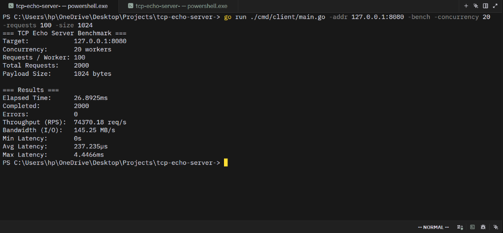

# TCP Echo Server

A concurrent, high-performance TCP Echo Server written from scratch in Go with graceful shutdown, atomic metrics, and a benchmarking/test client.

## Features

- **Concurrent Connection Handling:** Uses lightweight Go goroutines per TCP connection to handle thousands of simultaneous clients.
- **Graceful Shutdown:** Intercepts `SIGINT` (Ctrl+C) and `SIGTERM` to cleanly drain active connections without socket leaks.
- **Configurable CLI Flags:** Customize port, bind address, buffer sizes, and idle timeouts.
- **Lock-Free Atomic Metrics:** Real-time tracking of total connections, active connections, and total bytes echoed via `sync/atomic`.
- **Built-in Benchmark Tool:** Includes an interactive client and multi-worker stress testing tool.

---

## Demos & Screenshots

### 1. Live Interactive Testing
Connect to the server and echo messages in real time:


### 2. High-Throughput Benchmark
Running 20 concurrent workers executing 2,000 requests (1KB payloads) on local sockets:



---

## Performance Benchmark Results

| Metric | Result |
| :--- | :--- |
| **Throughput** | **~74,370 requests/sec** |
| **Bandwidth (I/O)** | **145.25 MB/s** |
| **Average Latency** | **237 µs** (0.23 milliseconds) |
| **Completed / Errors** | **2,000 / 0 errors (100% success)** |

---

## Quick Start

### 1. Start the Server

Using `go run`:
```powershell
go run . -port 8080
```

Or build and run the compiled binary:
```powershell
go build -o tcp-echo-server.exe .
.\tcp-echo-server.exe -port 8080
```

### CLI Options

| Flag | Default | Description |
| :--- | :--- | :--- |
| `-port` | `8080` | Port to listen on |
| `-host` | `0.0.0.0` | Host IP address to bind to |
| `-buf` | `4096` | Buffer size in bytes for socket read/write operations |
| `-idle-timeout` | `0s` (disabled) | Maximum idle duration before closing a connection (e.g. `30s`, `1m`) |

---

## Testing the Server

### 1. Live Interactive Mode
Connect to the server and send messages live from the terminal:
```powershell
go run ./cmd/client/main.go -addr 127.0.0.1:8080
```

### 2. High-Speed Benchmark
Run a high-concurrency stress test with 20 workers sending 100 requests each (1KB payloads):
```powershell
go run ./cmd/client/main.go -addr 127.0.0.1:8080 -bench -concurrency 20 -requests 100 -size 1024
```

### 3. Netcat
Connect using standard netcat (WSL / Linux / macOS):
```bash
nc 127.0.0.1 8080
```

---

## Automated Unit & Integration Tests

Run the full automated test suite:
```powershell
go test -v ./...
```
